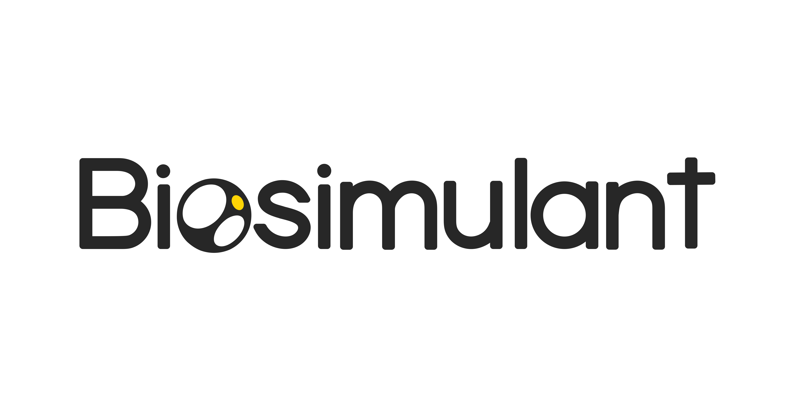

# Biosimulant for Claude



**Run, record, and revisit life sciences experiments.**

Start a life sciences investigation in Claude. Find evidence, work with data and
models, and run computational experiments with your approval. Biosimulant keeps
the setup, results, and research notes together in Studio so you can check what
happened, rerun it, or pick up where you left off.

## Install in Claude

1. Open **Customize → Plugins → Add → Upload plugin** and select the Biosimulant
   Claude ZIP. This installs a development copy in your account; it is not a
   public directory listing.
2. Open the plugin's **Connectors** tab and add or connect Biosimulant.
3. Sign in to your Biosimulant account and review the requested permissions.
   Where Claude offers an OAuth client choice, select **Register automatically**:
   Biosimulant supports public clients registered dynamically with PKCE.
4. Enable Biosimulant in the conversation's connectors menu and try a request below.

You can also add the connection alone under **Customize → Connectors → Add custom
connector**, using the name **Biosimulant** and URL
`https://api.biosimulant.com/mcp`. This gives Claude access to the service without
installing the packaged workflow skills. Use one connection to avoid duplicate tools.
Workspace owners may need to enable custom plugins and connectors first.

## Claude Code

For a development copy, extract this ZIP and start Claude Code with:

```sh
claude --plugin-dir /absolute/path/to/biosimulant
```

Use `/mcp` to authenticate the Biosimulant connection. The four skills load from
the plugin's `skills` directory. A direct connection without the bundled skills is:

```sh
claude mcp add --transport http biosimulant https://api.biosimulant.com/mcp
```

## Try it

| Skill | Try asking |
| --- | --- |
| Start or continue an investigation | “Pick up my protein-binding study. What have we tried, and what's still open?” |
| Build or adapt a model | “Find a published model I can adapt. What does it assume, and what would I need to change?” |
| Run or repeat an experiment | “Prepare a rerun with the saved settings. Show me the inputs and estimated cost before I approve it.” |
| Inspect and compare results | “Compare my two completed runs. What changed in the setup, and what do the saved outputs support?” |

For example, open a saved Boltz-2 investigation, review the predicted structure
and scores alongside the exact setup in Studio, then ask Claude to prepare a
rerun. Use your own saved run or follow the [Biosimulant walkthrough](https://www.biosimulant.com/#demo).

The assistant must inspect the live tool inventory and exact records before
claiming success. It must ask for approval of the exact plan before running
compute or publishing. A missing input is a reason to explain the gap, not invent
data. Public publication requires separate approval.

## Access and data

The only configured connection is the HTTPS Biosimulant service at
`https://api.biosimulant.com/mcp`, using Streamable HTTP and OAuth. Each person
signs in to their own account; this package contains no API keys, shared passwords,
tokens, local server, installation scripts, or hooks. It does not alter Claude's
permission settings. Revoke access through your Biosimulant account when needed.

Biosimulant receives the arguments needed for your requested actions and retains
scientific records, private workspace content, inputs, and results. Relevant
outputs return to Claude. The workflow may request research records from the
approved sources described in the skills through Biosimulant's service, and may
read or author the scientific files you explicitly ask to use. Respect source
licenses and keep credentials out of prompts and files.

All scientific execution and automated validation use the declared Biosimulant
server. The model-building skill includes optional requirements and technical
planning templates. The package does not run
local simulations or scientific artifact-processing code. The optional local
file-transfer helper only reads user-selected bytes, computes their checksum,
and encodes upload chunks; it needs existing host filesystem/script access.

Results are for research. Successful execution or an Evidence Passport does not
establish clinical validity, efficacy, safety, or general model accuracy. Retain
source attribution, units, assumptions, uncertainty, and intended-use limits.

[Privacy](https://www.biosimulant.com/privacy) ·
[Terms](https://www.biosimulant.com/terms) ·
[Support](https://www.biosimulant.com/contact)

## Distribution status

This repository supplies the Biosimulant package for the Claude directory.
You can use the manual connection above while the directory listing is under
review. Available tools depend on the connected Biosimulant account and service.
