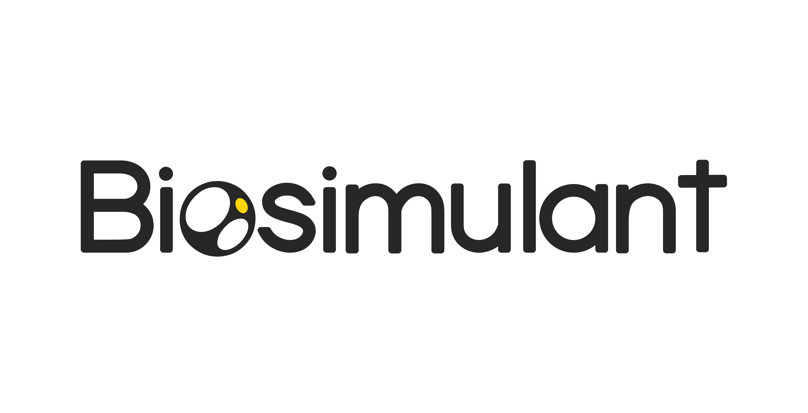

# Biosimulant for Claude



Research life sciences evidence, build private models and labs, run computational
experiments, and inspect results in a conversation with Claude. Start with a
research question, find published evidence or your existing work, prepare a model
or experiment, and read its saved results with their assumptions and limitations.

The package includes three skills: Biosimulant's research workflow, model
requirements, and model technical specifications. They guide the work; your
Biosimulant account controls access. Responses use plain English while preserving
scientific quantities, uncertainty, and approval requirements.

## Install in Claude

1. Open **Customize → Plugins → Add → Upload plugin** and select the Biosimulant
   Claude ZIP. This installs a development copy in your account; it is not a
   public directory listing.
2. Open the plugin's **Connectors** tab and add or connect Biosimulant.
3. Sign in to your Biosimulant account and review the requested permissions.
   Where Claude offers an OAuth client choice, select **Register automatically**:
   Biosimulant supports public clients registered dynamically with PKCE.
4. Enable Biosimulant in the conversation's connectors menu and try a request below.

You can also add the connection alone under **Customize → Connectors → Add custom
connector**, using the name **Biosimulant** and URL
`https://api.biosimulant.com/mcp`. This gives Claude access to the service without
installing the packaged workflow skills. Use one connection to avoid duplicate tools.
Workspace owners may need to enable custom plugins and connectors first.

## Claude Code

For a development copy, extract this ZIP and start Claude Code with:

```sh
claude --plugin-dir /absolute/path/to/biosimulant
```

Use `/mcp` to authenticate the Biosimulant connection. The three skills load from
the plugin's `skills` directory. A direct connection without the bundled skills is:

```sh
claude mcp add --transport http biosimulant https://api.biosimulant.com/mcp
```

## Try it

- Find a published physiology lab and explain its assumptions and limitations.
- Summarize my existing life sciences project, including drafts and completed runs.
- Draft requirements for an exploratory model using only the evidence I supplied.
- Prepare a simulation from a selected published lab and show its inputs and cost.
- Read my completed experiment's actual saved results and explain what they establish.

The assistant must inspect the live tool inventory and exact records before
claiming success. It must ask for approval of the exact plan before running
compute or publishing. A missing input is a reason to explain the gap, not invent
data. Public publication requires separate approval.

## Access and data

The only configured connection is the HTTPS Biosimulant service at
`https://api.biosimulant.com/mcp`, using Streamable HTTP and OAuth. Each person
signs in to their own account; this package contains no API keys, shared passwords,
tokens, local server, installation scripts, or hooks. It does not alter Claude's
permission settings. Revoke access through your Biosimulant account when needed.

Biosimulant receives the arguments needed for your requested actions and retains
scientific records, private workspace content, inputs, and results. Relevant
outputs return to Claude. The workflow may request research records from the
approved sources described in the skills through Biosimulant's service, and may
read or author the scientific files you explicitly ask to use. Respect source
licenses and keep credentials out of prompts and files.

All scientific execution and automated validation use the declared Biosimulant
server. The requirements and technical-specification skills contain templates
and review guidance, without executable local helpers. The package does not run
local simulations or scientific artifact-processing code. The optional local
file-transfer helper only reads user-selected bytes, computes their checksum,
and encodes upload chunks; it needs existing host filesystem/script access.

Results are for research. Successful execution or an Evidence Passport does not
establish clinical validity, efficacy, safety, or general model accuracy. Retain
source attribution, units, assumptions, uncertainty, and intended-use limits.

[Privacy](https://www.biosimulant.com/privacy) ·
[Terms](https://www.biosimulant.com/terms) ·
[Support](https://www.biosimulant.com/contact)

## Distribution status

This is an initial development package. Local validation does not prove successful
sign-in, tool use across Claude clients, or approval by Anthropic. Before a public
listing, test the package in Claude and submit the remote connector and plugin
bundle through Anthropic's developer portal. The plugin repository must be public
before the listing goes live. No Claude directory submission is included in this ZIP.

File ingestion and dataset inspection guidance is packaged in version 1.0.6.
Use these tools only when exposed by the connected server. This source update
does not deploy the backend or refresh an installed connector inventory.
